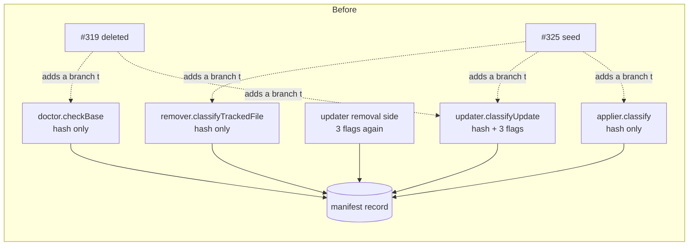
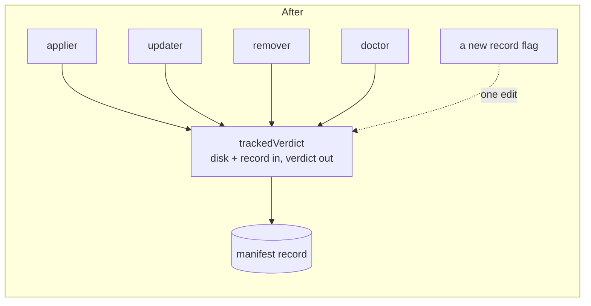

# Full-project refactor proposal

Created on 2026-11-11. Source revision is `a46a4dd3` on `main`. This document proposes structural changes for review. It touches no source file.

It follows [0002](0002-refactor-full-project-2026-09-15.md), the survey from 2026-09-15. 556 commits landed since then, and 18 pull requests are open. This survey reads `main` for structure and reads the open pull requests for one thing only: which files several of them edit at once, and why.

## Coverage

Ranked 1,251 tracked code files by churn across 1,329 commits (one year of history, docs and the lockfile excluded). Co-change pairs skip commits that touch more than 40 files. Read about 58 files in full and about 100 in part, across five areas of `main`, plus the hunks of all 18 open pull requests for the 31 files that three or more of them edit.

Six subagents on the Sonnet model read the code: one per area and one for the pull requests. The main session derived the churn ranking, the co-change pairs and the cross-PR file overlap, then checked every claim behind the crowned candidate and the claims marked "verified" below against the working tree. The survey ran no tests and no build.

| Area | Hot files (commits in one year) | Read |
| --- | --- | --- |
| CLI commands | `add.ts` 50, `init.ts` 29, `update.ts` 26, `remove.ts` 19, `doctor.ts` 19 | 6 in full, 5 in part |
| CLI library and schemas | `applier.ts` 39, `registry-item.schema.json` 26, `updater.ts` 21, `schema.ts` 21, `doctor.ts` 20, `manifest.ts` 18, `patch/index.ts` 17, `remover.ts` 15 | 9 in full, 14 in part |
| Feature and app modules | `admin/registry-item.json` 23, `auth/registry-item.json` 21, `auth/files/src/auth.ts` 17, `api/files/src/index.ts` 14, admin `__root.tsx` 12, admin `app-shell.tsx` 10 | 13 in full, 14 in part |
| Capability cores, providers, drivers | cold: no file above 10 commits apart from `package.json` bumps | 7 in full, about 15 in part |
| Template, scripts, `apps/web` | `apps/web/src/content/landing.ts` 21, `oxlint.config.mjs` 21, `update-deps.ts` 15, `release-smoke.ts` 10 | 7 in full, about 25 in part |
| Open pull requests | 786 distinct files across 18 PRs, 31 of them edited by three or more | every hunk of the 31 shared files |

Limits a reader should know. The agents did not read `merge-plan.ts`, `update-notes.ts`, `semver.ts`, `collisions.ts`, `base.ts`, `registry.ts`, the patch codemod files, `commands/list.ts` or `commands/new.ts`. Several ADRs were read by title or first screen only; each candidate below names the ADRs its agent read in full. "Would conflict" for two pull requests means their hunks touch the same old lines, computed from the diffs and not from a trial merge.

## What happened to the 0002 candidates

| 0002 candidate | Status on `main` today |
| --- | --- |
| 1. One ledger for the manifest, config and lock | Landed. `lib/ledger.ts` (`persistLedger`) and the record functions in `lib/manifest.ts:116-200`. No other file writes `manifest.managed`. |
| 2. One tracked-file verdict | Half landed. `classifyTrackedFile` is exported from `remover.ts:42` and the updater's delete side calls it. The applier and the updater's overwrite side keep their own. Carried as candidate 1. |
| 3. A refusal travels as a code | Open. Two admin screens still match `message === "no active organization"`. Carried as candidate 5. |
| 4. Api-key scope guard as a pure rules file | Half landed. `api-keys-user` has `api-key-rules.ts` and its test. `api-keys-organization` does not. Carried as candidate 15. |
| 5. One confirm-or-refuse gate | Half landed. `lib/prompts.ts` refuses with no terminal (ADR 0046). The "Proceed?" block still exists three times. Carried as candidate 13. |
| 6. Share the patch-kind schema | Open for the third survey. Carried as candidate 12. |
| 7. `update-deps.ts` imports the CLI terminal helpers | Open. `update-deps.ts:535-575` still copies `stripAnsi` and `wrapForNote`. One file to change. |
| 8. One skill-link planner | Open, and the two copies have diverged on the symlink guard. Carried as candidate 10. |
| 9. One plan renderer for three commands | Open. Dropped this time: the three action vocabularies differ, so one renderer would take three label maps and relocate the code. |
| 10. Derive descriptor types from the schema | Open. `schema.ts:109-252` still mirrors the schema by hand. Not re-listed; the fan-out numbers below are its evidence. |
| 11. One argv splitter | Open and wider: `parseArgs` now exists in ten commands. Not one of the three read-the-code patterns, so it is not re-listed. |
| 12. Scaffold the capability-core contract once | Dropped this time. Eight selectors exist now and three differ on purpose (`logger` optional, `payment` list-valued, `sms` coerces `retryable`). A generator would relocate the text. A guard test replaces it as candidate 19. |
| 13. Export the `verify-content` scanner | Overtaken. `verify:content` now runs in CI on every push (`ci.yml:59`), so its inline fixtures run there. |
| 14. One `name@version` parser | Open, still weak. |

`modules/infra` and `modules/rbac` no longer exist (commits `76cdf6d9` and `976046c7`), so the 0001 infrastructure candidate is closed.

## Poor locality: the two signals from history and from the open queue

**A descriptor field fans out.** One new field in `registry-item.json` costs these many existing source and schema files, measured from the commits that added each one (tests, docs and module descriptors not counted):

| Change | Commit | Files |
| --- | --- | --- |
| Patch kind `nav-entry` | `4e3b3fdb` | 4, and six tables inside `patch/index.ts` |
| Field `conflictsWith` | `a63bc6a9` | 5 |
| Field `requires` | `b18beb2e` | 6 |
| `requiresOneOf` mirrored into the lock | `2f42e402` | 8 |
| Field `when` | `56a26a90` | 12 |

The strongest co-change pairs outside test-to-source pairs are `add.ts` with `applier.ts` (17 commits), `update.ts` with `updater.ts` (12), `registry-item.schema.json` with `schema.ts` (12), with `applier.ts` (11) and with `add.ts` (10). Candidates 1, 7, 11 and 12 each shorten this fan-out.

**The open queue edits the same files.** 31 files are edited by three or more of the 18 open pull requests. Reading the hunks sorts them into four kinds:

| Kind | Files | What it means |
| --- | --- | --- |
| Hand-kept module catalogue | `docs/wiki/modules.md` (6 PRs), `modules/README.md` (6), `README.md` (4), `CONTEXT.md` line 57 (2) | Every new module appends a row or a name. #281 and #282 both edit the same line in three files. Plan 0107 already schedules a generated catalogue, so this is not listed as a candidate. |
| A rule that two PRs each extend | the tracked-file record (`deleted` from #319, `seed` from #325), the first-user hook in `auth.ts` (#320 deletes it, #324 extends it), the `cors()` call in `api/files/src/index.ts` (#318, #322, #324) | Evidence for candidates 1 and 18. |
| One JSX call that each feature adds a prop to | admin `app-shell.tsx`: `attention` (#321), `rootWrappers` (#325), `trail` (#330), `fetchNavCount` (#323) | Evidence for candidate 6. |
| A hand-kept list of projects | `packages/cli/vitest.tooling.config.ts` `projects` array (#318, #320, #321, #322, and #280 deletes a block) | One glob over `vitest.config.ts` files would remove it. Small, noted under "Outside the four patterns". |

The rest of the 31 are skill files and descriptors where the edits sit in different sections.

## Ranked candidates

Strength follows the refactorkit scale. `strong`: both gates pass, the files are in the churn top slice, and the blast radius is named in files. `moderate`: both gates pass but the code is cold or the blast radius is wide. `weak`: the gates pass but nothing changes about what a caller must know. Every listed candidate passes both gates.

| Rank | Candidate | Pattern | Strength | Blast radius |
| --- | --- | --- | --- | --- |
| 1 | **One tracked-file verdict for the applier, updater, remover and doctor** (crowned) | untested coupling | strong | 4 existing files, 1 new |
| 2 | One guarded write for the three engines | untested coupling | strong | 4 files; `update` gains a refusal |
| 3 | An incoming-resolution stage between `compareInstalled` and `buildUpdatePlan` | untested coupling | strong | 2 files, 1 new |
| 4 | One lock source for `update`, `outdated`, `env` and backfill | adapter prevalence | strong | 4 files, 1 new |
| 5 | A denial carries a code (carried from 0002) | adapter prevalence | strong | 10 files, 2 admin screens |
| 6 | The shell ships the pure app glue once | adapter prevalence | moderate | about 20 files in 3 modules, 1 update note |
| 7 | One lock-entry projection | adapter prevalence | strong | 3 files |
| 8 | Requirement settling leaves `runAdd` | untested coupling | strong | 3 files |
| 9 | One recorder for update-note state | untested coupling | strong | 2 files, 1 new test |
| 10 | One skill-link planner and executor (carried from 0002) | untested coupling | moderate | 3 files |
| 11 | One record per patch kind | untested coupling | moderate | 2 files |
| 12 | A shared `patch.schema.json` (carried from 0001 and 0002) | adapter prevalence | moderate | 6 files |
| 13 | One `confirmApply` for add, update and remove | untested coupling | moderate | 4 files |
| 14 | `plugin-array` takes a list of export names | shallow interface | moderate | CLI patch engine, schema, 3 descriptors |
| 15 | A pure rules file for the organization api-key guard | untested coupling | moderate | 2 files, 1 descriptor entry |
| 16 | One enumerator of shipped modules for the scripts | adapter prevalence | moderate | 10 files |
| 17 | One scaffold step builder for the scripts | untested coupling | moderate | 5 files, 1 new |
| 18 | One origin list for `api` and `auth` | untested coupling | moderate | 5 files |
| 19 | Selector and provider tests for `email` and `sms`, and one contract guard | untested coupling | moderate | 5 new test files |
| 20 | Export and test the colour helpers in `verify-preset.ts` | untested coupling | moderate | 2 files |
| 21 | One skill-link reporter for add, update and init | adapter prevalence | moderate | 4 files |
| 22 | One `fail`, `step` and `run` for the scripts | adapter prevalence | weak | 8 files |
| 23 | One semver parser and one `name@version` splitter in `scripts/` | shallow interface | weak | 2 files |
| 24 | Driver parity guard for twin schemas and lifecycle scripts | adapter prevalence | weak | 1 test file |

Candidate 1 is crowned. It sits on the hottest library files, it is the half of 0002's second candidate that did not land, and two open pull requests each add a new input to the rule it concentrates. Candidate 2 is smaller and closes a live gap; it can ship first without waiting for the crown.

## 1. One tracked-file verdict for the applier, updater, remover and doctor (crowned)

### Problem and evidence

The CLI asks one question about every file it tracks: given the bytes on disk and the manifest record, may the tool overwrite or delete this file? On `main` that question has five spellings (verified):

| Site | What it reads | Rule |
| --- | --- | --- |
| `applier.ts:512-565` `classify` | disk, `managed.hash` | hash equal means `overwrite`, else `drift`; no record means `conflict` |
| `updater.ts:1145-1167` `classifyUpdate` (private) | disk, base, theirs, hash, `adopted`, `mergedWith`, `projectOwned` | eight-way matrix; any of the three flags sends an existing file to `drift` (ADR 0034) |
| `updater.ts:896-908` removal side | the same three flags, then `classifyTrackedFile` | the three-flag rule written a second time |
| `remover.ts:42-50` `classifyTrackedFile` | disk, hash | hash only |
| `doctor.ts:1289-1301` `checkBase` | disk, hash | hash only, with its own root-manifest version exception beside `keepRootVersion` in `updater.ts:1013` |

Each engine also re-checks the file just before it writes: `stillMatches` in `applier.ts:1098` and in `updater.ts:1356`, and `recheckFile` in `remover.ts:458`.

Three costs follow.

The sites disagree. The updater treats an `adopted` or `mergedWith` record as no licence to overwrite. The applier and the remover test the hash alone. An `adopted` record holds a hash taken off disk, so the hash matches by construction and `add` over such a file plans an `overwrite`. Whether `add --force` and `remove` should honour the three flags is an open decision for the owner; today nothing states that the difference is intended.

The rule is growing in the open queue. PR #319 adds `deleted` to the manifest record with new `deleted` and `kept-deleted` verdicts in the updater and a tombstone branch in `doctor.ts`. PR #325 adds `seed` to the record with a new `classifySeed` in the updater, a seed branch in the applier and a `seedSurvivors` list in the remover. After both merge, the record carries five flags and four engines read them, each in its own function. Both PRs also claim ADR number `0059`.

Two names may describe one rule. `projectOwned` is documented at `updater.ts:1125` as "the template hands this file over once and never comes back for it". `seed` in #325 is documented as "written once, then the project's". The first applies to base files and the second to module files. A plan should decide whether they are one verdict input.

The matrix is reachable only through a whole plan. `classifyUpdate` is private, so `updater.test.ts` (2,129 lines) builds a temp project and a temp module directory to reach each row: 67 plan-build calls and 70 `writeModule` calls. `applier.test.ts` (3,715 lines) has 91 plan-build calls and `remover.test.ts` (2,094 lines) has 61. Only the remover's two-line function is tested as a function (`remover.test.ts:69-80`).

### Proposed shape

A new `packages/cli/src/lib/tracked-file.ts` exports one pure function. Each engine reads the disk itself, calls the function, and maps the verdict onto its own action names, as `DELETE_ACTION` (`updater.ts:349`) already does for the remover's answer.

```ts
type TrackedVerdict =
  | "untracked"   // no manifest record
  | "absent"      // tracked, gone from disk
  | "pristine"    // tracked, bytes equal the recorded hash, hash is ours
  | "edited"      // tracked, bytes differ
  | "handed-over"; // tracked, but the record is no licence to write:
                   // adopted, mergedWith, projectOwned (and seed, deleted once they land)

function trackedVerdict(input: {
  disk: string | undefined;
  entry: ManagedEntry | undefined;
  projectOwned: boolean;
}): TrackedVerdict;
```

The comparison against `base` and `theirs` stays in the updater, because only an update has an incoming revision. The re-check before a write becomes "the verdict is the same as at plan time", one helper for three engines.





### Why it is deeper

Today a caller must know the hash rule, the three flags, which of them its engine honours, and the re-check. After the change a caller knows five verdict names. A new record flag is one edit and one table test, not one branch per engine. The disagreement between the engines becomes a visible mapping in each engine, where a reviewer can read it.

### Gate verdicts

Deletion test passes. Five functions and three re-check helpers lose the hash-versus-record rule and it sits in one file; the disk reads stay in each engine, where they belong. Nothing moves to the commands.

Interface as test surface passes. The verdict is a table test over strings and record literals with no temp directory. The existing plan tests stay as integration checks, and the rows that only assert a classification can move to the table.

### Blast radius

New `packages/cli/src/lib/tracked-file.ts` and its test. Edits to `lib/applier.ts`, `lib/updater.ts`, `lib/remover.ts` and `lib/doctor.ts`. No command file changes. `classifyTrackedFile` moves and keeps its export for the updater's delete side.

### Constraints and timing

ADR 0034 (update never writes a file it did not write) and ADR 0006 (manifest hash tracking) constrain the verdict and are not reversed. ADR 0031 is untouched. Extending the three-flag rule to `add` and `remove` is a new decision and needs a line in the plan.

PR #319 and PR #325 both rewrite the functions this candidate concentrates. Start the work after both merge, and fold `deleted` and `seed` into the verdict as its first two additions. Starting earlier forces both PRs to rebase over a moved rule.

## 2. One guarded write for the three engines

### Problem and evidence

The applier calls `assertNoSymlinkPath` before its file write, its patch write and its link create (`applier.ts:1136`, `1165`, `1206`). The remover guards its patch read and write (`remover.ts:299`, `549`). `updater.ts` does not call it at all (verified: 0 matches) and writes at `:1445` and `:1501` and calls `createDirLink` at `:1516`. `createDirLink` (`fs-utils.ts:226-234`) carries no guard of its own. `applier.test.ts:1754` covers the applier's refusal. `updater.test.ts` has no symlink case.

The rule is a habit at each call site, and the engine that lacks it has no failing test. This survey did not try to exploit the gap; it reports that the guard is absent on the update path.

### Proposed shape

`writeWithinRoot(root, abs, content)` and a guarded link create in `lib/fs-utils.ts`. The symlink refusal moves inside them. The engines stop calling `writeFile` and `assertNoSymlinkPath` as a pair.

### Gate verdicts

Deletion test passes. The guard-then-write pair collapses into one function and three engines stop restating it.

Interface as test surface passes. A temp directory with one symlinked parent proves the refusal through the helper alone, with no registry and no manifest.

### Blast radius

`lib/fs-utils.ts`, `lib/applier.ts`, `lib/updater.ts`, `lib/remover.ts`. Behaviour change: `update` starts to refuse a symlinked path component. No ADR is reversed.

## 3. An incoming-resolution stage between `compareInstalled` and `buildUpdatePlan`

### Problem and evidence

`commands/update.ts` is 1,799 lines and `lib/updater.ts` is 1,616. `runUpdate` alone runs from line 639 to 1550 as one function whose closures share `baseNotes`, `adoptedBefore`, `cleanups` and `sources`. Lines 1155 to 1352 are not parsing and not output. They fetch three revisions per module, build each `ModuleUpdateInput` by hand (`:1256-1266`), collect `cliRefusals` and `conflictRefusals` (`:1211-1227`), union every resolved graph and re-run `detectConflicts` (`:1280-1303`), then run `detectMissingRequirements` over the union (`:1328`).

The rule "a conflicting pair split across two graphs refuses the run" is testable only through `runUpdate`. `update.test.ts:375-397` needs `process.chdir`, `REGISTRY_ENV`, a hand-written `saasaloy.json`, a lock and a manifest (`:300-333`), a fixture registry on disk and stderr capture to assert it.

### Proposed shape

`lib/update-incoming.ts` with `gatherIncoming({ outdated, remote, config, lock, cliVersion, registryOverride })` returning `{ inputs, skipped, refusals }`. It hides the three-revision fetch, the rule that a fetch failure skips one module while a policy violation refuses the run, and the union check.

### Gate verdicts

Deletion test passes. The decision sits beside `buildUpdatePlan`, and `runUpdate` loses a 200-line block that shares eight closure variables with the rest.

Interface as test surface passes. `gatherIncoming` takes a `remote` factory and returns data, so each refusal is an input and an assertion with no project on disk.

### Blast radius

`commands/update.ts`, new `lib/update-incoming.ts`, `commands/update.test.ts` (cases at `:269-470` can become unit tests). ADR 0044 and ADR 0034 stay true. PR #319 changes `update.ts` by more than 3,000 lines across the PR; start after it merges.

## 4. One lock source for `update`, `outdated`, `env` and backfill

### Problem and evidence

A lock entry's `source` is a string, `owner/repo` or `local`. Four places re-parse it into a registry source and disagree on what is valid (verified): `update.ts:632` and `backfill.ts:68` reject extra segments, `outdated.ts:222` requires exactly two parts, and `env.ts:268` runs `const [owner, repo] = entry.source.split("/")`, which accepts `a/b/c` as `a/b`. The message "isn't an owner/repo coordinate" is written in all four files. `update.ts` and `outdated.ts` each keep a source cache and a cleanup loop; the comment at `outdated.ts:271` says "the same cache `update` keeps". The base-row comparison is written twice (`outdated.ts:262-269`, `update.ts:937-943`).

### Proposed shape

`lib/lock-source.ts`: `openLockSource(entry, { rev, override })` returns a source or a skip reason, and a `SourcePool` caches by slug and ref, owns cleanup and takes an injectable opener.

### Gate verdicts

Deletion test passes. Four parsers, two caches and two cleanup loops collapse into one unit, and slug validity gets one answer.

Interface as test surface passes. `outdated.test.ts:261-264` starts a local HTTP fixture to reach one comparison row; with an injected opener the same rows are testable in memory.

### Blast radius

`commands/update.ts`, `commands/outdated.ts`, `commands/env.ts`, `lib/backfill.ts`, new `lib/lock-source.ts`. ADR 0012 constrains it: the lock pins the resolved SHA, so the `resolved` revision mode must stay.

## 5. A denial carries a code (carried from 0002)

### Problem and evidence

`Denial` is `{ status, message }` (`modules/auth/files/src/authorize.ts:133`). Three sites turn it into an exception: `denialError` in `auth/files/src/server.ts:64`, a byte-identical copy in `multitenant/files/auth/tenant.ts:97`, and an inline copy at `multitenant/files/auth/permissions.ts:51`. `errorFor` in `api/files/src/index.ts:67` derives the error code from the HTTP status, so every 403 is `forbidden`. Two admin screens then match prose: `message === "no active organization"` at `multitenant/files/admin/routes/roles.tsx:89` and `api-keys-organization/files/admin/routes/api-keys.tsx:81`. `multitenant/files/admin/lib/tenant.ts:54` invents the same string on the client. `tenant-rules.ts:38` carries the comment "Change it here and change the SPA in the same commit."

This is the second survey to list it.

### Proposed shape

`Denial` gains an optional `code`. One exported `denialError(denial)` builds the exception with the code. `errorFor` writes it into `error.code`. The screens test `code === "no_active_organization"`.

### Gate verdicts

Deletion test passes. Three translators become one, and the prose match leaves the screens for the place the denial is minted.

Interface as test surface passes. `denialError` and `errorFor` are pure; `tenant-rules.test.ts:57-66` already pins the string and can pin the code.

### Blast radius

`auth/files/src/authorize.ts` and `server.ts`; `multitenant/files/auth/tenant.ts`, `permissions.ts`, `tenant-rules.ts` and its test; `api/files/src/index.ts`; `roles.tsx`; `api-keys.tsx`; `multitenant/files/admin/lib/tenant.ts`. No ADR is reversed. The api envelope is documented as matching the validators' `errorSchema`, so the two change together. Three open PRs edit `api/files/src/index.ts`.

## 6. The shell ships the pure app glue once

### Problem and evidence

ADR 0047 says a third app "gets the same frame with no copy". The frame is shared but the glue around it is copied between `modules/admin/files/src` and `modules/app/files/src` (verified by `diff`):

| File | admin | app | Differing lines |
| --- | --- | --- | --- |
| `lib/initials.ts` | 25 | 25 | 0 |
| `components/route-error.tsx` | 28 | 28 | 0 |
| `components/shell-extensions.ts` | 12 | 12 | 0 |
| `components/commands.ts` | 96 | 97 | 21 |
| `lib/redirect.ts` | 80 | 82 | 12 |

The tests are copied too (`initials.test.ts`, `redirect.test.ts`, `commands.test.ts`). The longest-prefix rule exists twice, as `areaFor` in admin `nav.ts:92` and as `pageLabelFor` in `shell-layout.tsx:44`. `fetchNavCount` and `useNavCounts` live only in the admin `app-shell.tsx`, which is why the client app has no live nav counts. Admin `app-shell.tsx` is 168 lines, about 130 of them helpers, and four open PRs each add one prop or wrapper to its single `<ShellLayout>` call.

### Proposed shape

`modules/shell` ships `initialsOf`, `areaFor(areas, path)`, a nav-to-commands builder that takes an id prefix, `resolveDestination` that takes the auth paths, `fetchNavCount` and a `RouteError` block. Each app keeps its router link, its session and its guard. `shell-extensions.ts` stays in each app because it is a patch target.

### Gate verdicts

Deletion test passes. Seven file pairs and three test pairs collapse into one tested copy; the open-redirect guard in `resolveDestination` gets one home.

Interface as test surface passes. The functions are pure and run under the node tests the shell already ships (`modules/shell/files/ui/lib/shell/*.test.ts`).

### Blast radius

New files under `modules/shell/files/ui/lib/shell/` and its descriptor; entries removed from `modules/admin/registry-item.json:154-204` and `modules/app/registry-item.json:121-150`; imports in both `main.tsx`, `app-shell.tsx` and `__root.tsx`; six test files become three; one update note under ADR 0058, because existing projects own the copies. `useNavCounts` needs react-query, so it stays in the apps unless a dependency patch is added.

Moderate, not strong: the blast crosses three modules and reaches installed projects, and PRs #321, #323, #325 and #330 all edit the same `app-shell.tsx`. Start after they merge. PR #325's `src/extend/root.tsx` seam is a step toward the same goal and should be read first.

## 7. One lock-entry projection

`lock.ts:126-131`, `updater.ts:1555-1557` and `updater.ts:1584-1586` each project the descriptor's `dependsOn`, `conflictsWith` and `requiresOneOf` into a lock entry, with two different emptiness tests. `ModuleUpdatePlan` carries six parallel fields (`updater.ts:462-489`) only to ferry those lists to the lock. Commit `2f42e402` touched eight files to mirror one list. Shape: `lockEntryFor(provenance, item)` in `lock.ts`, and one `graphFacts` field on the plan in place of three plus three. Deletion test passes (three projections and six fields disappear). Test surface passes (pure, by object literal). Blast radius: `lib/lock.ts`, `lib/updater.ts`, the fixture at `lib/merge-plan.test.ts:64-66`. ADR 0012 and ADR 0031 stay. Strong, and the smallest strong candidate on the list.

## 8. Requirement settling leaves `runAdd`

`commands/add.ts:1001-1074` holds one algorithm inside `runAdd`: the `--with` fixed-point loop (`:1014-1028`), the interactive loop capped by `MAX_REQUIREMENT_PROMPTS` (`:1048-1068`), three refusal conditions (`:1035`) and `mergePicked` (`:966-978`). The tests at `add.test.ts:1600-1739` build a temp project and registry, call `process.chdir`, force `process.stdin.isTTY = false` and capture stdout to reach it. Shape: `settleRequirements({ graph, rooted, config, withNames, mode, registry, ask })` beside `lib/requires.ts`, returning the merged graph or a refusal. Deletion test passes (75 lines leave `runAdd` and stop depending on its closures). Test surface passes (with `ask` and the resolver injected, each rule is a table row). Blast radius: `commands/add.ts`, one lib file, `commands/add.test.ts`. ADR 0046 constrains it: no terminal means refuse and name the flag, and `--yes` must not pick a driver. The rest of `add.ts` is a linear flow with tested helpers, and its size is honest.

## 9. One recorder for update-note state

What an applied run records about update notes sits in three closures in `commands/update.ts`: `advanceBaseRange` (`:973-982`), `recordNotes` (`:985-989`) and `reportDone` (`:990`). The up-to-date branch detects a change by comparing `JSON.stringify([manifest.pendingNotes, manifest.doneNotes, lock.base])` before and after (`:1103-1114`). Shape: `recordShownNotes(...)` in `lib/pending-notes.ts` returns `changed`, and the command persists when it is true. Deletion test passes (the stringify and the closures vanish into one function beside the selection logic). Test surface passes (plain `Manifest` and `Lockfile` objects in, a boolean out). Blast radius: `commands/update.ts`, `lib/pending-notes.ts`, one new test. ADR 0058 and ADR 0032 constrain it.

## 10 to 24, in brief

**10. One skill-link planner and executor.** `applier.ts:889-894` and `updater.ts:1181-1186` hold the same `missing/correct/conflict` ternary, and `applier.ts:1197-1210` and `updater.ts:1507-1520` hold the same execute loop; only the applier guards it. Shape: `planSkillLinks` and `applySkillLinks` in `lib/skill-links.ts`. Deletion test passes (two plan copies and two execute copies become one). Test surface passes (a bare temp dir suffices). Blast: `skill-links.ts`, `applier.ts`, `updater.ts`. ADR 0015 constrains it. Folds into candidate 2.

**11. One record per patch kind.** A patch kind registers in six lookups inside `patch/index.ts` (`Patch` union `:116`, `PATCH_KIND_KEYS` `:132`, `matchExisting` `:209`, `applyCodemod` `:223`, `INVERSES` `:268`, two refusal tables `:325`). The three optional tables make a forgotten entry read as a deliberate "no inverse", and `index.test.ts:320-327` pins `isReversibleKind` for six kinds while `drizzle-column` and `nav-entry` are also in `INVERSES`. Shape: one `KINDS` record keyed by kind. Deletion test passes (six tables become one). Test surface passes (`applyPatch`, `reversePatch` and `isReversibleKind` are already the public surface). Blast: `patch/index.ts` and its test. PR #279 adds a ninth kind, `const-property`.

**12. A shared `patch.schema.json`.** Both JSON schemas spell the kind enum (`registry-item.schema.json:215-262`, `manifest.schema.json:162-171`) and `schema.test.ts:38-52` keeps them equal. The manifest does not check a recorded patch's payload, although `remove` replays it. Shape: one schema file both `$ref`. Deletion test passes (two enums and a parity test become one definition). Test surface passes (`validateRegistryItem` and `validateManifest`). Blast: both schemas, the new file, `schema.ts`, `schema.test.ts`, and `registry-floors.test.ts`, which must then drift-check both files or a new kind escapes the ADR 0044 floor. Third survey to list it.

**13. One `confirmApply`.** The pre-plan refusal "No terminal to confirm in" is written in `add.ts:1077`, `update.ts:743` and `remove.ts:243` with two different predicates (`process.stdin.isTTY` twice, `isInteractive()` once). The "Proceed?" prompt and its exit mapping is written three times (`add.ts:1211-1224`, `update.ts:1606-1624`, `remove.ts:363-376`). Deletion test passes (three predicates become one). Test surface passes (pure over `{ yes, preview, canAsk }` with an injected prompt). Blast: three commands and `lib/prompts.ts`. ADR 0046 constrains it.

**14. `plugin-array` takes a list of export names.** ADR 0050 runs two auth instances, so every feature plugin needs one descriptor record per instance: `teams` has 6 records for 3 registrations, `api-keys` 6 for 3, `billing-stripe` 2 for 1. Commit `f4dc646e` fixed a plugin that was missing from one instance. Shape: `exportName` accepts `["auth", "adminAuth"]`. Deletion test passes (the "both audiences" rule sits once in the patch engine). Test surface passes (apply one record, assert two arrays). Blast: the CLI patch code, the schema, the remover inverse, three descriptors, and a `requires.saasaloy` floor. The agent did not read the patch code, so the cost on the CLI side is an estimate.

**15. A pure rules file for the organization api-key guard.** `api-keys-organization/files/auth/plugins/api-key.ts:127-170` is the privilege gate on key issue, with five silent allow arms and no test. Its sibling `api-keys-user` already has `api-key-rules.ts` and a test. Deletion test passes (five arms in one tested function). Test surface passes (each arm is an argument). Blast: that file, a new rules file and test, one descriptor entry. ADR 0036 and ADR 0055 constrain it. Cold code, but it is the one untested permission decision the survey found.

**16. One enumerator of shipped modules for the scripts.** Nine scripts and guard tests each read `modules/*` their own way, with three different filters for "is this a module" (`env-presets.test.ts:72-93`, `test-file-gates.test.ts:30-43`, `seed-slices.test.ts`, `table-names.test.ts:31-37`, `skills.test.ts:106-111`, `config-shim.ts:49`, `release-smoke.ts:649-680`, `update-deps.ts:306-345`, `apps/web/src/lib/module-catalog.test.ts:222-229`). Each redeclares a local descriptor type. 0002 dropped a shared `readdir`; the count has since grown from three to nine, and the unit proposed here is a payload enumerator, `shippedModules()` and `shippedEntries(module)` in `scripts/lib/shipped.ts`. Deletion test passes (the rule for what a module ships sits in one place). Test surface passes (a fixture registry). Blast: ten files. Plan 0107 adds more guard tests, each of which would otherwise add a tenth copy.

**17. One scaffold step builder for the scripts.** Six places own "init, git init, add each module, install, env setup" with the same workarounds written out again: `release-smoke.ts:687-720`, `855-890` and `1186-1192`, `verify-e2e.ts:162-242`, `verify-preset.ts:183-185`, `watch-template.ts:132-159` and the `play:init` chain in `package.json:37`. `release-smoke.test.ts` tests pure helpers only; the orchestration has no test. Deletion test passes (the sequence and three workarounds sit in one module). Test surface passes (a step builder returns vectors that a test can assert in order). Blast: five files and one new one. PR #283 adds a seventh sequence under `play:up`, and PR #285 edits `release-smoke.ts`.

**18. One origin list for `api` and `auth`.** `DEV_ORIGINS` is written in `api/files/src/index.ts:40` and `auth/files/src/auth.ts:37`, and the split-and-fallback logic is written twice (`index.ts:117-121`, `auth.ts:43-48`) under a comment that claims "one origin list, two readers". `modules/api` ships no test. Deletion test passes (one edit point and one tested rule). Test surface passes (pure over strings). PR #322 deletes `DEV_ORIGINS` from both files, so this candidate should be judged again after #322 merges.

**19. Selector and provider tests for `email` and `sms`, and one contract guard.** `email` and `sms` are the two cores of eight with no `define.test.ts`. Nothing tests the unset-provider throw, the unknown-provider throw, the E.164 check, `countSegments`, or the `retryable` coercion at `sms/files/src/provider.ts:181`. `email-plunk` (312 lines of status mapping) and `email-cloudflare` have no test, while every other vendor provider has one. Shape: the missing test files, plus one table-driven `scripts/capability-contract.test.ts` that asserts for every core that an unset or unknown `<CAP>_PROVIDER` throws, with `logger` and `payment` as declared exceptions. Deletion test passes (the invariant from `AGENTS.md` gets one enforcer; the copies stay because projects own them). Test surface passes (`define<Cap>({ providers: [stub] }).create(env)` needs no collaborator). Blast: five new test files. This fits plan 0107's enforcer table.

**20. Export and test the colour helpers in `verify-preset.ts`.** `verify-preset.ts:118-175` holds `parseOklch`, `sameColor` and `readRootPrimary`. Two bugs were fixed there (`18a4ad65`, `0c523834`) and the file has no test, because importing it runs the playground drill at line 184. Deletion test passes (the tolerance rule gets a tested home). Test surface passes (strings in). Blast: the script and a new file.

**21. One skill-link reporter.** `add.ts:1290-1317`, `update.ts:1692-1725` and `init.ts:486-516` each turn the same `SkillLinkResult` into prose with different wording, and two of them splice `unreadable` into `failures` as a fake entry. `commands/backfill-report.ts` is the precedent. Deletion test passes. Test surface passes (a result in, lines out). Blast: four files.

**22 to 24 (weak, listed and never crowned).** `fail`, `step` and `run` are copied across eight scripts with only the prefix changed. `scripts/` holds two semver parsers and three `name@version` splits. The twin-schema guard in `table-names.test.ts:124-137` compares table names and not columns, and no test asserts that the two database drivers patch the same lifecycle script keys; no drift exists today.

## Dropped on the gates

- A shared plan renderer for add, update and remove (0002 candidate 9): three vocabularies, so one renderer relocates three label maps.
- A `ProjectDisk` port injected into the three planners: about 30 touchpoints that forward one-to-one to `fs-utils`, which is itself a shallow interface.
- A generator for the capability-core contract in `saasaloy new`: relocates the text, and three of eight selectors differ on purpose.
- A shared runtime selector across cores: not available, because a core has zero runtime dependencies and the project owns the files.
- Generating each provider's `env.ts` from descriptor `envVars`: relocates, and `scripts/env-presets.test.ts` already guards agreement.
- Merging the two drivers' script patches, or the twin schemas: ADR 0042 and the ADR 0026 amendment reject both by name.
- Splitting `lib/doctor.ts` by concern: it is a list of pure checks with plain-object tests; a split relocates.
- A bound output wrapper so `update.ts` stops passing `TUI_ON_STDERR` 79 times: the wrapper would forward each member to one clack call.
- `apps/web` as a fork of the template's landing blocks: `CONTEXT.md:455` declares the fork, and the six shared blocks have 0 co-changes with their template copies in a year.
- The `package.json` co-changes across modules and the template: dependency bumps through `pnpm deps:update` (ADR 0016), an accepted cost.

## Open pull request queue

These are not structural candidates. They are what the hunk reading found, listed because the request covered the open pull requests.

**State.** 18 open, about 70,700 added lines. #276, #280, #281, #282 and #285 conflict with `main`. #322 has two failing checks. The other twelve are mergeable and green.

**Pairs that cannot both merge as written.**

- #320 deletes the first-user promotion hook in `modules/auth/files/src/auth.ts` for a security reason. #324 adds a branch inside that hook. #324 needs rework after #320. #325's skill text still describes the hook.
- #323 and #324 make the same fix: both add `modules/app/files/tsr.config.json` and change the app `typecheck` script to `tsr generate && tsc --noEmit`. One of them should drop it.
- #319 and #325 both claim ADR `0059` for two different decisions. QA serial `0083` is used by #276, #281, #283 and #285, and `0093` by #318 and #320. Each needs a new serial at merge. The serial rule in `AGENTS.md` lists one directory, and a branch cannot see the others.
- #281 and #282 edit the same line in `modules/payment/registry-item.json` (the `PAYMENT_PROVIDER` description), in `modules/README.md`, in `README.md` and in `CONTEXT.md`.
- #321, #325 and #330 each change the one `<ShellLayout>` call in admin `app-shell.tsx`; #325 re-indents the block the other two add props to.
- #280 edits 37 descriptors and moves about 76 test files, and it keeps the name `billing`. It overlaps #276 and seven other PRs.

**An order that follows the overlaps.** #279 before #286. #320 before #324 and #325. #325 before #330. #319 and #325 before candidate 1 starts. #276 and #280 first or last, because they touch the most files; each day they wait, more PRs land under them.

**A pattern worth copying.** #325's `AUDIT_ACTIONS` is a `plugin-array` patch that `admin`, `payment` and `feature-flags` each add from their own directory, with no shared file edit. That is the shape the registration points above lack.

## Outside the four patterns

Short notes the agents found on the way. None is a refactor candidate.

- `deps:check` runs in no workflow (verified: no match under `.github/`), although `AGENTS.md` and `CONTRIBUTING.md:367` call it "the read-only CI gate".
- `docs/wiki/modules.md` has no row for `e2e`, `env-infisical` or `file-uploads`, and the `README.md` tier table omits those three plus `app` and `shell` (verified). No test reads either file. `apps/web/src/content/landing.ts:214-246` links to the wiki by text fragments that quote its prose, so an edited row silently breaks the link. Plan 0107 item 1 (the generated catalogue) fixes the table; the text-fragment links need their own check.
- `CONTRIBUTING.md:469` says to run `verify:content` by hand; CI runs it.
- `.agents/skills/create-provider/SKILL.md:13` says a second runtime file means "you are authoring a capability". Since ADR 0039 and ADR 0041, four providers ship an `env.ts` preset as a second file. The skill should name the preset.
- `LOGGER_PROVIDER` is optional and falls back to `providers[0]` (`logger/files/src/define.ts:187-205`), which departs from the `AGENTS.md` rule "never fall back to a default". The code comments say it is intended; `AGENTS.md` names `logger` as following the provider shape without naming this exception.
- The tier vocabulary differs by reader: `commands/list.ts:136` has two tiers, `apps/web/src/lib/module-catalog.ts` has four, and the wiki calls the two api-key owners "feature (owner)" while ADR 0055 and `CONTEXT.md` call them drivers.
- `packages/cli/vitest.tooling.config.ts` keeps a hand-written `projects` array that five open PRs edit.
- `oxlint.config.mjs:322-330` lists by hand the modules that run on workerd, and `sms`, `storage`, `payment` and `billing` are absent. The agent did not check whether that changes a lint result.
- Modules that ship no test: `api` and `waitlist`.

## Handoff

This survey wrote one file, this one, and touched no source file.

1. Merge #319 and #325 first. Give one of them a new ADR number.
2. Turn candidate 1 into a phased plan with `/plankit docs/refactor/0003-refactor-full-project-2026-11-11.md`. One phase per safe intermediate state: the pure verdict and its table test; then the remover and doctor; then the applier; then the updater; then `deleted` and `seed`.
3. Put the open decision in that plan: do `add` and `remove` honour `adopted`, `mergedWith` and `projectOwned`? Record the answer with `/domainkit` if it amends ADR 0034.
4. Send the plan to `/grillkit`, then to `/implementkit`.
5. Candidate 2 needs no plan. It can go straight to an issue.
6. Candidates 16 and 19 fit Phase 3 of plan 0107 and can be added there.
